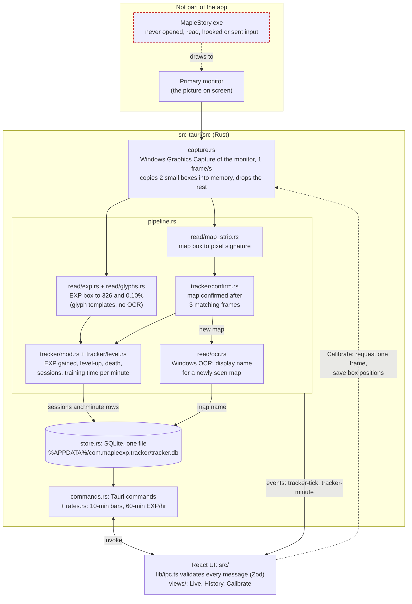

# Maple EXP Tracker

A Windows desktop app that measures EXP/hr in MapleStory Classic World by reading the screen. Once a second, it captures the primary monitor (the same way OBS "Display Capture" does). It reads the EXP readout and the minimap's map name from that image in memory, and records EXP gained per map in a local SQLite file.

**The app never touches the game.** It does not open, read, inject into or hook the MapleStory process, read game files, target the game window, send keyboard or mouse input, or draw an overlay. It never writes screenshots to disk.

## How it works



### Reading the diagram

- **Input.** The only input is the monitor image. `capture.rs` asks Windows for frames of the primary monitor (`Monitor::primary()`), never a window. It copies two small rectangles out of each frame and drops the rest.
- **Reading.** Readers in `read/` are pure functions (no I/O): pixels in, values out. The EXP number is matched against glyph shapes stored as ASCII art in `glyphs.rs`. The map is identified by its pixel signature, and OCR only produces a display name the user can rename.
- **Pipeline.** `pipeline.rs` is one background thread that runs the readers and tracker on each frame. It is the only place that writes to the database.
- **Tracking.** `tracker/` has no I/O. It turns each second's reading into effects (`SessionStarted`, `SessionEnded`, `Minute`), which `pipeline.rs` writes to SQLite. Repot trips and AFK time count as zero training seconds, so they don't lower the rate.
- **UI.** The UI only talks to the backend through Tauri commands and two events. Every payload is validated with Zod in `lib/ipc.ts`.
- **Logs.** A text log in `%LOCALAPPDATA%\com.mapleexp.tracker\logs\` (5 files of up to 1 MB) records reader failures with the partially read text, map and session changes, tracker decisions (level-up, death, rejected misreads), capture restarts and database errors, plus one summary line per minute. It contains text only, never images.
- **Dev tool.** `src/bin/glyph_collect.rs` is a developer-only tool for capturing new digit shapes. It is built only with the `dev-tools` feature and is not part of the release build.

## Development

```bash
pnpm install
pnpm tauri dev                                  # run the app
cargo test --manifest-path src-tauri/Cargo.toml # reader + tracker tests
pnpm tauri build                                # NSIS installer
```
