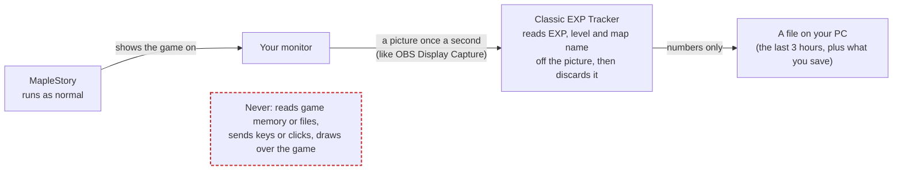

# Classic EXP Tracker

A Windows desktop app that measures EXP/hr in MapleStory Classic World by reading the screen. Once a second, it captures the primary monitor (the same way OBS "Display Capture" does). It reads the EXP readout, the level and the minimap's map name from that image in memory, and records EXP gained per map in a local SQLite file.

**The app never touches the game.** It does not open, read, inject into or hook the MapleStory process, read game files, target the game window, send keyboard or mouse input, or draw an overlay. It never writes screenshots to disk.



> **Status:** submitted to Nexon for review against the MapleStory Terms of Service. It won't be released publicly until Nexon confirms in writing that it's allowed.

## Install

1. Download `Classic EXP Tracker_<version>_x64-setup.exe` from the [Releases page](https://github.com/Kwuasimoto/classic-exp-tracker/releases).
2. Run it. The installer isn't code-signed, so Windows SmartScreen may say "Windows protected your PC": choose **More info**, then **Run anyway**.
3. It installs for your user account only (no administrator rights) and adds a Start menu entry.

**Requirements:** Windows 10 version 2004 or later, or Windows 11, 64-bit. The installer downloads Microsoft Edge WebView2 if it's missing (Windows 11 already has it). On Windows 10, Windows draws a yellow border around the screen while the app captures it; Windows 11 lets the app hide it. Map names are read with Windows' built-in text recognition, which needs a Windows display language that supports it, such as English.

## Set up (once)

1. **Put MapleStory on your primary monitor**, with the status bar (EXP and level) and the minimap visible, and the minimap showing the map name. The app reads only the primary monitor. If you have a second monitor, the app opens there so it doesn't cover the game; with one monitor, keep the app's window away from the EXP bar and minimap.
2. Open the app and go to **Calibrate**, then press **Grab frame**.
3. With **EXP** selected, drag a box tightly around the numbers after "EXP." Leave room on the right for longer numbers.
4. Check the **Map** box covers the street and map name under the minimap title, and the **Level** box covers only the number after "LV.". At 1920×1080 both start in the right place; at other resolutions, drag them yourself.
5. Press **Preview**. When it shows your EXP, percentage, map and level correctly, press **Save**.

The app reads characters by matching them against the glyph library for your screen resolution. The 1920×1080 library starts with the EXP characters already in it; the level digits, and EXP glyphs at any other resolution (where the game is stretched and the characters look different), are learned while you play. When the app meets a character it can't place, it says **Unknown EXP characters** and keeps the shape on the **Glyphs** page: type which character it is, and EXP is read from then on. Characters that can only be one thing (for example `[`, or a digit only one value fits) are learned without asking.

## Use

- **Live** shows your EXP/hr over the last 60 minutes of training, %/hr, time to level and EXP to level, with a chart of EXP per 10 minutes. Time in town or AFK doesn't lower the rate.
- The **save** button left of 2H/3H saves what the chart shows to History as a snapshot. The **reset** button next to it starts a new session and saves nothing.
- Only one copy of the app runs at a time; opening it again brings the open window forward.
- **Glyphs** keeps one library per screen resolution, with a tab for each; the one for your current resolution is used automatically (marked **in use**). Each shows the characters learned (with any still missing) and, under **Unknown**, shapes waiting for you to name. **Change** corrects a learned glyph's character and **Forget** removes it; **Dismiss** hides a shape that isn't a character (something over the EXP box). **Export** saves a resolution's setup, its calibration boxes and learned glyphs (character shapes as text, not screenshots), to `classic-exp-tracker-config.json`. **Import** loads such a file: its boxes replace yours for that resolution and its glyphs are added, so a friend with the same screen setup can use yours without calibrating.
- **History** lists your snapshots, which can be renamed and deleted. Snapshots are the only history kept: live data is deleted once the 3H chart no longer shows it, so save anything you want to keep.
- The status line at the bottom of the side nav says whether reading works. If it doesn't:
  - **EXP not readable:** the status bar is hidden or covered, or the EXP box moved. Recalibrate.
  - **Unknown EXP characters:** open **Glyphs** and name the shapes under **Unknown**.
  - **Map name not readable:** open the minimap.
  - **Not calibrated for this screen resolution:** calibration is saved per resolution; calibrate again at the new one.
  - **Screen capture failed:** another app or the game is blocking capture. The app stops rather than working around it.

## Your data

Everything stays on your PC; the app makes no network requests.

- History: `%APPDATA%\com.classicexp.tracker\tracker.db`
- Logs (text only): `%LOCALAPPDATA%\com.classicexp.tracker\logs\`

To uninstall, use **Settings > Apps > Installed apps > Classic EXP Tracker**. Your history is kept unless you tick **Delete the application data** in the uninstaller.

## How it works (for reviewers and developers)

- **Input.** The only input is the monitor image. `capture.rs` asks Windows for frames of the primary monitor (`Monitor::primary()`), never a window. It copies three small rectangles (EXP, map name, level) out of each frame and drops the rest.
- **Reading.** Readers in `read/` are pure functions (no I/O): pixels in, values out. Each EXP glyph is centred on its centre of brightness and compared with the current resolution's glyph library, stored as ASCII art in the database (table `glyphs`); the 1920×1080 library starts with the set in `glyphs.rs`, recorded at that resolution. A glyph that isn't clearly one character fails the read rather than guessing. `screen/exp_learner.rs` learns an unknown EXP glyph only when exactly one character makes the readout parse and fit the level total implied by earlier readings; other unknown shapes wait in `unknown_glyphs` for the user to name on the Glyphs page. The map is identified by its pixel signature, and OCR only produces its display name; a Roman numeral at the end of it ("The Burnt Land II") becomes a number, since OCR mixes up I, l and 1. The level digits (`read/level.rs`) don't start with any glyphs, because only the current level's digits are ever on screen: when the level box shows a digit the app hasn't seen while the level is already known from the EXP readings, the app labels it from that level and stores it in the database as the same kind of ASCII art.
- **Pipeline.** `pipeline.rs` is one background thread. For each frame, `screen/` runs the readers, confirms map changes, follows the level box and logs reader failures, without any I/O; `pipeline.rs` then feeds the tracker, names new maps with OCR and saves the results. It is the only place that writes to the database.
- **Tracking.** `tracker/` does no I/O apart from log lines explaining its decisions. It turns each second's reading into effects (`SessionStarted`, `SessionEnded`, `Minute`), which `pipeline.rs` writes to SQLite. Repot trips and AFK time count as zero training seconds, so they don't lower the rate. `tracker/level.rs` holds the EXP-per-level table (a community table, **not confirmed by Nexon**; corrections welcome). The level is the one whose table total fits the EXP and % readings; a level read from the screen is used only when its table total fits them too.
- **UI.** The UI only talks to the backend through Tauri commands and one event (`tracker-tick`, once a second). Every payload is validated with Zod in `lib/ipc.ts`. The save button on the Live chart copies what the chart shows into a snapshot (listed in History, renamable and deletable); the reset button starts a new session. Stored minutes older than the 3H chart needs are deleted as new ones are saved, so snapshots are the only lasting history. Its look follows [`docs/STYLE.md`](docs/STYLE.md); the backdrops in `public/` are MapleStory wallpapers, chosen in the side nav (or none).
- **Logs.** A text log in `%LOCALAPPDATA%\com.classicexp.tracker\logs\` (5 files of up to 1 MB) records reader failures with the partially read text, map and session changes, tracker decisions (level-up, death, rejected misreads), capture restarts and database errors, plus one summary line per minute. It contains text only, never images.
- **Dev tool.** `src/bin/glyph_collect.rs` is a developer-only tool that records the EXP box as text, replays recordings through the reader, and prints glyphs the reader rejects. It is built only with the `dev-tools` feature and is not part of the release build.

## Development

```bash
pnpm install
pnpm tauri dev                                  # run the app
cargo test --manifest-path src-tauri/Cargo.toml # reader + tracker tests
pnpm tauri build                                # NSIS installer
```

Needs Node.js 20.19+ or 22.12+, pnpm, the Rust toolchain (stable, MSVC) and the [Tauri prerequisites for Windows](https://tauri.app/start/prerequisites/). The installer is written to `src-tauri/target/release/bundle/nsis/`.

To release, set the same version in `package.json`, `src-tauri/Cargo.toml` and `src-tauri/tauri.conf.json`, run `pnpm tauri build`, and attach the installer to a GitHub release.

## Credits and license

The backgrounds in `public/` are official MapleStory wallpapers; MapleStory and its artwork are © Nexon. This project isn't affiliated with or endorsed by Nexon.

Copyright © 2026 Kwuasimoto. All rights reserved. The source is published for review and transparency; no license is granted to reuse it.
