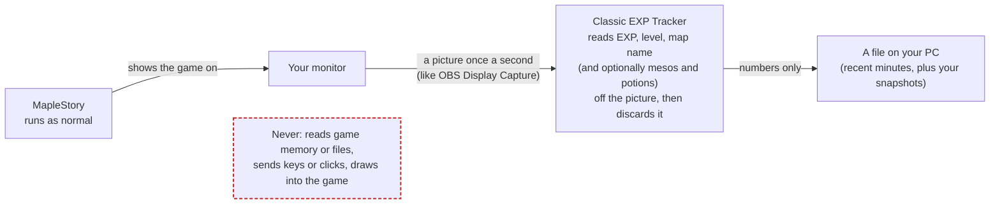

# Classic EXP Tracker

A Windows desktop app that measures EXP/hr (and, if you turn it on, mesos/hr) in MapleStory Classic World by reading the screen. Once a second, it captures the primary monitor (the same way OBS "Display Capture" does). It reads the EXP readout, the level and the minimap's map name from that image in memory, and records EXP gained per map in a local SQLite file. With meso tracking on, it also reads the inventory's meso total and Etc stacks and the potions on the quickslot.

**The app never touches the game.** It does not open, read, inject into or hook the MapleStory process, read game files, target the game window, send keyboard or mouse input, or draw into the game. It never writes screenshots to disk. The optional pinned rates are the app's own small window, kept on top like any always-on-top window and left out of screen capture.



> **Use at your own risk.** This is a fan-made tool, not affiliated with or reviewed by Nexon. It only reads what your monitor shows, but whether any third-party tool is allowed is up to Nexon's Terms of Service.

## Install

1. Download `Classic.EXP.Tracker_<version>_x64-setup.exe` from the [Releases page](https://github.com/Kwuasimoto/classic-exp-tracker/releases).
2. Run it. The installer isn't code-signed, so Windows SmartScreen may say "Windows protected your PC": choose **More info**, then **Run anyway**.
3. It installs for your user account only (no administrator rights) and adds a Start menu entry.

### Check your download

Every installer on the Releases page is built by GitHub, not on anyone's PC: the [Release workflow](.github/workflows/release.yml) checks out the release's commit, runs the tests, builds the installer and uploads it, and nothing else is uploaded. The workflow also has GitHub sign a [build-provenance attestation](https://docs.github.com/en/actions/security-for-github-actions/using-artifact-attestations) of the file: a public, tamper-proof record of the installer's SHA-256, the workflow run and the commit it was built from. Each release's notes list the SHA-256 and link the run and the commit. To check a download in PowerShell:

```powershell
(Get-FileHash '.\Classic.EXP.Tracker_<version>_x64-setup.exe' -Algorithm SHA256).Hash   # same as in the release notes
gh attestation verify '.\Classic.EXP.Tracker_<version>_x64-setup.exe' --repo Kwuasimoto/classic-exp-tracker
```

`gh attestation verify` (from the [GitHub CLI](https://cli.github.com/)) fails unless the file is byte for byte the one this repository's workflow built, and prints the commit it came from.

Building the installer yourself from the same commit works, but gives a file with a different hash: the Rust compiler and the NSIS installer builder write build times and paths into what they produce, so no two builds of this app are byte-identical. That's why the attestation, rather than a rebuild, is what ties a download to the source.

**Requirements:** Windows 10 version 2004 or later, or Windows 11, 64-bit. The installer downloads Microsoft Edge WebView2 if it's missing (Windows 11 already has it). On Windows 10, Windows draws a yellow border around the screen while the app captures it; Windows 11 lets the app hide it. Map names are read with Windows' built-in text recognition, which needs a Windows display language that supports it, such as English.

## Set up

1. **Set Windows to a 16:9 resolution and play MapleStory full screen** on your primary monitor. **1366×768** is the game's own resolution: its text is drawn pixel for pixel there and reads best. Larger 16:9 sizes such as 1920×1080 work too. Other shapes, such as 1280×960 or ultrawide, aren't supported yet: the game stretches its text unevenly there.
2. Keep the status bar (EXP and level) and the minimap visible, with the minimap showing the map name. The app reads only the primary monitor. If you have a second monitor, the app opens there so it doesn't cover the game; with one monitor, keep the app's window away from the EXP bar and minimap.

There's nothing to calibrate: the app knows where the game draws EXP, the map name and the level, and scales those spots to your screen. EXP is read from the game's own pixel font, so there's nothing to teach. The level digits are learned by themselves while you play, per screen resolution.

**Meso tracking** is off until you turn it on in **Mesos**. Then push the inventory into the corner chosen there (top right, bottom right or bottom left), keep its **Etc** tab open, and keep the quickslot showing (either the controller or the keyboard layout). New items show up in **Mesos › Items** to be named from the game's item list; an unnamed item counts for nothing until it is. Choose your main HP and MP potions under **Live › Active pots**: only those two count as potions burned.

## Use

- **Live** shows your EXP/hr over the last 60 minutes of training, %/hr, time to level and EXP to level, with a chart of EXP per 10 minutes. Time in town or AFK doesn't lower the rate.
- The **lock** next to the map name pins the live view to that map: while it's locked, the chart, EXP/hr, %/hr, time to level and saved snapshots count only EXP and training time on that map, so repot trips and quest turn-ins elsewhere don't touch the average. Everything is still recorded; unlocking counts every map again. The lock stays on across restarts and resets until you unlock it.
- With meso tracking on, **Profit/hr** (mesos picked up, plus Etc at NPC prices, minus potions burned) sits beside EXP/hr, and **Active pots** shows your main HP and MP potions, how many are on the quickslot, and which quickslot layout is being read. Click a pot's line to choose another from your quickslot.
- **Totals** count EXP (and profit) on every map since you last reset them, across restarts.
- The **pushpin** in the side nav pins a small window with the rates, time to level and a session clock on top of the game. Drag it anywhere; it's left out of screen capture, so it can't hide what the app reads.
- The **save** button left of 2H/3H saves what the chart shows to History as a snapshot. The **reset** button next to it ends the current grind and starts a new session.
- Only one copy of the app runs at a time; opening it again brings the open window forward.
- The map's name comes from a list of the game's map names. A map not on that list shows as **Unrecognised map** and is still tracked; the pencil next to the name lets you name it (or rename any map), and the app never asks you to.
- In shops the game collapses the minimap to a grey title bar; the app shows **Shopping** then, and the time doesn't count as training.
- **History** lists your snapshots, which can be renamed and deleted. Each grind is saved there by itself when it ends: your time on one map, through repot trips, once you've been away from it for 30 minutes (or press reset), if it had at least 10 minutes of training. Automatic snapshots are deleted after 30 days unless you keep them (the bookmark button); ones you save yourself stay. Snapshots are the only lasting history.
- The status at the top right of each page says whether reading works. If it doesn't:
  - **EXP not readable:** the game isn't full screen, or the status bar is hidden or covered.
  - **Map name not readable:** open the minimap.
  - **… isn't 16:9:** set Windows to a 16:9 resolution, such as 1366×768 or 1920×1080.
  - **Screen capture failed:** another app or the game is blocking capture. The app stops rather than working around it.

## Your data

Everything stays on your PC; the app makes no network requests.

- History: `%APPDATA%\com.classicexp.tracker\tracker.db`
- Logs (text only): `%LOCALAPPDATA%\com.classicexp.tracker\logs\`

To uninstall, use **Settings > Apps > Installed apps > Classic EXP Tracker**. Your history is kept unless you tick **Delete the application data** in the uninstaller.

## How it works (for reviewers and developers)

- **Input.** The only input is the monitor image. `capture.rs` asks Windows for frames of the primary monitor (`Monitor::primary()`), never a window. It copies a few small rectangles out of each frame (EXP, level, map name, and the minimap's title bar, which tells shops apart; with meso tracking on, the inventory and the quickslot too) and drops the rest. The rectangles are fixed spots measured at the game's own resolution, 1366×768, and scaled to the monitor (`geom.rs`); that works because the game stretches its whole screen to the monitor, which keeps the spots in proportion on any 16:9 screen.
- **Reading.** Readers in `read/` are pure functions (no I/O): pixels in, values out. The EXP readout is drawn in a 5×7 pixel font scaled to the screen. `read/font.rs` holds that font and recognises each glyph by drawing every character at the line's measured scale, at sub-pixel offsets, and comparing the drawing with the screen by normalised correlation. A glyph that isn't clearly one character fails the read rather than guessing. Glyphs that touch are cut apart by the font's pitch (`read/exp.rs`). The map is identified by the pixel signature of its name, and a map can have several (one per resolution and minimap width). Its name is read with Windows OCR and accepted only if it matches a name in `data/maps.txt`, the game's map names from the MapleStory Classic Wiki: exactly, or within a misread letter when one name is clearly closest (`read/map_names.rs`). Anything else stays unrecognised rather than shown misread, and is read again a few times while you stay on the map. The level digits (`read/level.rs`) don't start with any glyphs, because only the current level's digits are ever on screen: when the level box shows a digit the app hasn't seen while the level is already known from the EXP readings, the app labels it from that level and stores it in the database (table `glyphs`) as ASCII art. Until then the level comes from the EXP readings alone.
- **Pipeline.** `pipeline.rs` is one background thread. For each frame, `screen/` runs the readers, confirms map changes, follows the level box and logs reader failures, without any I/O; `pipeline.rs` then feeds the tracker, names new maps with OCR and saves the results. It is the only place that writes to the database.
- **Tracking.** `tracker/` does no I/O apart from log lines explaining its decisions. It turns each second's reading into effects (`SessionStarted`, `SessionEnded`, `Minute`), which `pipeline.rs` writes to SQLite. Repot trips and AFK time count as zero training seconds, so they don't lower the rate. `tracker/level.rs` holds the EXP-per-level table (a community table, **not confirmed by Nexon**; corrections welcome). The level is the one whose table total fits the EXP and % readings; a level read from the screen is used only when its table total fits them too.
- **UI.** The UI only talks to the backend through Tauri commands and one event (`tracker-tick`, once a second). Every payload is validated with Zod in `lib/ipc.ts`. Each grind is saved as a snapshot when it ends (`grinds.rs`): the sessions on one map less than 30 minutes apart, kept if they had 10 minutes of training, from the first to the last minute of training. Automatic snapshots are deleted after 30 days unless kept from History; the save button on the Live chart saves what the chart shows, for good, and the reset button ends the grind and starts a new session. Stored minutes older than the 3H chart needs are deleted once their grind is filed, so snapshots are the only lasting history. Its look follows [`docs/STYLE.md`](docs/STYLE.md).
- **Logs.** A text log in `%LOCALAPPDATA%\com.classicexp.tracker\logs\` (5 files of up to 1 MB) records reader failures with the partially read text, map and session changes, tracker decisions (level-up, death, rejected misreads), capture restarts and database errors, plus one summary line per minute. It contains text only, never images.
- **Dev tool.** `src/bin/glyph_collect.rs` is a developer-only tool that records the EXP box as text, replays recordings through the reader, prints each glyph's match scores, and prints the glyphs it can't read with their closest characters. It is built only with the `dev-tools` feature and is not part of the release build.

## Development

```bash
pnpm install
pnpm tauri dev                                  # run the app
cargo test --manifest-path src-tauri/Cargo.toml # reader + tracker tests
pnpm tauri build                                # NSIS installer
```

Needs Node.js 20.19+ or 22.12+, pnpm, the Rust toolchain (stable, MSVC) and the [Tauri prerequisites for Windows](https://tauri.app/start/prerequisites/). The installer is written to `src-tauri/target/release/bundle/nsis/`.

To release, set the same version in `package.json`, `src-tauri/Cargo.toml` and `src-tauri/tauri.conf.json` and push. Then run the **Release** workflow from the Actions tab: it runs the tests, builds the installer on GitHub's Windows runner and attaches it to a draft release tagged `v<version>`. Review the draft and publish it.

## Credits and license

Two other open trackers shaped the EXP reader and the map naming. No code was copied from either:

- The idea that the EXP text is a 5×7 pixel font the game scales up, read as that font at any scale, comes from xEmPIr3's MapleStory Classic EXP tracker.
- Matching OCR reads of map names against a list of the game's map names, allowing a misread letter only when one name is clearly closest and the numbers agree, also follows beanguri's tracker.
- Comparing glyphs by normalised correlation with a little shift tolerance (and its score limits), and cutting touching digits by the font's pitch, come from [beanguri/Maple-Classic-Exp-Overlay](https://github.com/beanguri/Maple-Classic-Exp-Overlay) (MIT).

The code is [MIT](LICENSE), copyright © 2026 Kwuasimoto, with two exceptions:

- The map and item names and prices in `src-tauri/data/maps.txt` and `items.txt` come from the [MapleStory Classic Wiki](https://mapleclassic.wiki/wiki/Category:Maps) and are licensed [CC BY-NC-SA 4.0](https://creativecommons.org/licenses/by-nc-sa/4.0/) by its contributors (see `src-tauri/data/LICENSE.md`).
- The test images in `src-tauri/tests/fixtures/` are crops of the game's screen (see the README there).

MapleStory and its art are © Nexon. This project isn't affiliated with or endorsed by Nexon.
