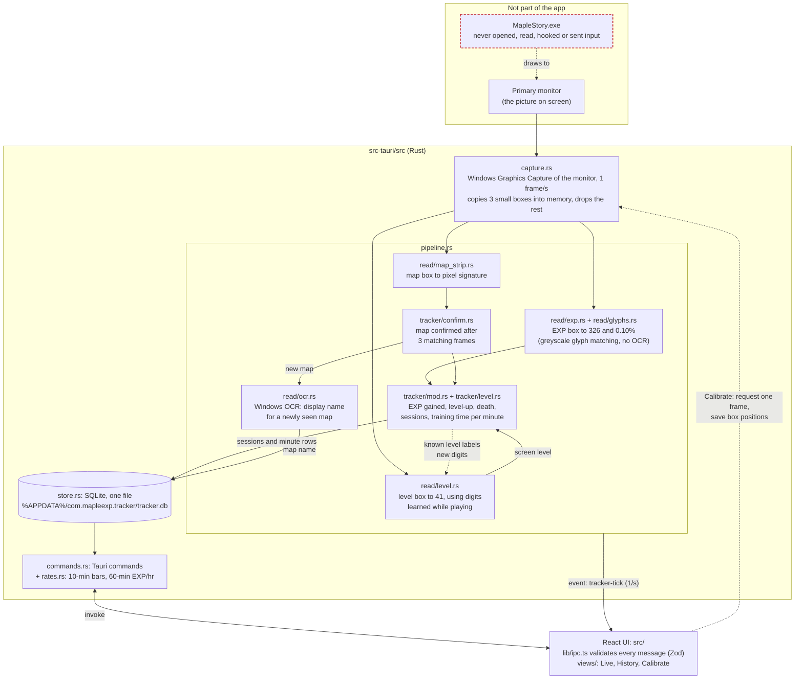

# Maple EXP Tracker

A Windows desktop app that measures EXP/hr in MapleStory Classic World by reading the screen. Once a second, it captures the primary monitor (the same way OBS "Display Capture" does). It reads the EXP readout, the level and the minimap's map name from that image in memory, and records EXP gained per map in a local SQLite file.

**The app never touches the game.** It does not open, read, inject into or hook the MapleStory process, read game files, target the game window, send keyboard or mouse input, or draw an overlay. It never writes screenshots to disk.

## How it works



### Reading the diagram

- **Input.** The only input is the monitor image. `capture.rs` asks Windows for frames of the primary monitor (`Monitor::primary()`), never a window. It copies three small rectangles (EXP, map name, level) out of each frame and drops the rest.
- **Reading.** Readers in `read/` are pure functions (no I/O): pixels in, values out. Each EXP glyph is centred on its centre of brightness and compared with one greyscale reference per character, stored as ASCII art in `glyphs.rs`; a glyph that isn't clearly one character fails the read rather than guessing. The map is identified by its pixel signature, and OCR only produces a display name the user can rename. The level digits (`read/level.rs`) have no built-in references, because only the current level's digits are ever on screen: when the level box shows a digit the app hasn't seen while the level is already known from the EXP readings, the app labels it from that level and stores it in the database as the same kind of ASCII art.
- **Pipeline.** `pipeline.rs` is one background thread that runs the readers and tracker on each frame. It is the only place that writes to the database.
- **Tracking.** `tracker/` has no I/O. It turns each second's reading into effects (`SessionStarted`, `SessionEnded`, `Minute`), which `pipeline.rs` writes to SQLite. Repot trips and AFK time count as zero training seconds, so they don't lower the rate. `tracker/level.rs` holds the EXP-per-level table (a community table, **not confirmed by Nexon**; corrections welcome). The level is the one whose table total fits the EXP and % readings; a level read from the screen is used only when its table total fits them too.
- **UI.** The UI only talks to the backend through Tauri commands and one event (`tracker-tick`, once a second). Every payload is validated with Zod in `lib/ipc.ts`. Its look follows [`docs/STYLE.md`](docs/STYLE.md); the backdrops in `public/` are MapleStory wallpapers, chosen in the side nav (or none).
- **Logs.** A text log in `%LOCALAPPDATA%\com.mapleexp.tracker\logs\` (5 files of up to 1 MB) records reader failures with the partially read text, map and session changes, tracker decisions (level-up, death, rejected misreads), capture restarts and database errors, plus one summary line per minute. It contains text only, never images.
- **Dev tool.** `src/bin/glyph_collect.rs` is a developer-only tool that records the EXP box as text, replays recordings through the reader, and prints glyphs the reader rejects. It is built only with the `dev-tools` feature and is not part of the release build.

## Development

```bash
pnpm install
pnpm tauri dev                                  # run the app
cargo test --manifest-path src-tauri/Cargo.toml # reader + tracker tests
pnpm tauri build                                # NSIS installer
```
