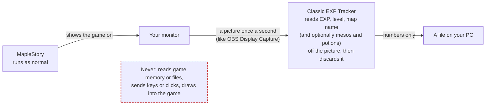

# Classic EXP Tracker

**See your EXP/hr, mesos/hr and time to level in MapleStory Classic World, live.**

It reads your screen like OBS does. It never touches the game.



- **EXP/hr, %/hr, time to level**: AFK and town trips don't drag it down.
- **Mesos/hr** (optional): mesos picked up + Etc value − potions used.
- **Pin it over the game**: a small always-on-top window with your rates.
- **Every grind saved by itself** in History.
- **Chat translator** (coming): Chinese, Korean, Japanese, Spanish, Portuguese and Thai chat in English.
- **In your language**: English, 简体中文, 한국어, 日本語, Español, Português (Brasil), ไทย, Tiếng Việt. It follows Windows; the globe button changes it.

## Install

1. Download `Classic.EXP.Tracker_<version>_x64-setup.exe` from [Releases](https://github.com/Kwuasimoto/classic-exp-tracker/releases).
2. Run it. If Windows says "Windows protected your PC": **More info** → **Run anyway** (the installer isn't code-signed).

Windows 10 (2004+) or 11, 64-bit. No admin rights needed.

**Updates:** the app checks for a new release 10 seconds after it starts and then every hour, downloads it in the background, and shows **Update to v…** in the title bar. It installs only when you click that; it never restarts by itself. Click the version number in the title bar to check now, or to turn the hourly checks off. Versions before the first one with updates (0.10.0 and older) need this one installed by hand.

## Set up

1. Play **full screen** on your main monitor at a **16:9** resolution (**1366×768** reads best; 1920×1080 works).
2. Keep the **EXP bar** and **minimap** visible.

That's it: nothing to calibrate.

**Mesos/hr:** turn it on in **Mesos**, keep your inventory in the chosen corner on the **Etc** tab, and pick your HP/MP pots in **Live › Active pots**. You can close the inventory: the rate holds and catches up when you open it again.

> Fan-made and not affiliated with Nexon. It only reads your screen, but use it at your own risk.

---

<details>
<summary><b>Everything it does</b></summary>

- **Live**: EXP/hr over the last 60 minutes of training, %/hr, time to level, EXP to level, and a chart of EXP per 10 minutes. Time in town or AFK doesn't count as training.
- **Lock** (next to the map name): count only this map, so repot trips and quest turn-ins elsewhere don't touch the average. Stays on until you unlock it.
- **Profit/hr** (meso tracking on): mesos picked up, plus Etc at NPC prices, minus your main HP/MP potions used. **Active pots** shows those potions, how many are on your quickslot, and whether it's reading the keyboard or controller quickslot.
- **Totals**: EXP and profit on every map since you last reset them.
- **Pushpin**: a small window with your rates and a session clock that stays on top of the game. It's left out of screen capture, so it can't hide what the app reads.
- **Save** saves what the chart shows to History; **reset** ends the current grind and starts fresh.
- **History**: every grind is saved by itself once you've been off its map for 30 minutes (or press reset), if it had 10+ minutes of training. Automatic ones are deleted after 30 days unless you keep them (bookmark); ones you save yourself stay.
- **Map names** come from the game's map list. A map not on it shows as **Unrecognised map**; the pencil renames it.
- **Shopping**: in shops the time doesn't count.
- **Chat translator**: translates with Google's Gemini and **your own API key** (free from [Google AI Studio](https://aistudio.google.com/apikey)); the app has no key or server of its own. Replies you write can already be translated into Chinese, Korean, Japanese, Spanish, Portuguese or Thai, to copy into the game. A translation is only shown if it keeps every amount (50k, 1.2m) as you wrote it. Reading the chat isn't switched on yet; it will need the chat reader (PaddleOCR text readers for Chinese and Japanese, Korean, Latin letters and Thai, about 30 MB), downloaded only when you click **Download** in Setup. **Turn on** stays disabled until then. Vietnamese chat isn't offered yet: the text reader it would use doesn't have Vietnamese's letters.
- **Languages**: the app follows Windows' display language if it has it, and the globe button at the bottom of the side nav picks another. The installer follows Windows' language too. Map and item names stay as the game shows them.

</details>

<details>
<summary><b>If something doesn't read</b></summary>

The status at the top right of each page says:

- **Can't see the game**: neither the EXP bar nor the minimap has shown any text for a minute. Play full screen on your main display.
- **EXP not readable**: the game isn't full screen, or the EXP bar is hidden or covered.
- **Map name not readable**: open the minimap.
- **… isn't 16:9**: set Windows to a 16:9 resolution.
- **Screen capture failed**: another app or the game is blocking capture. The app stops rather than working around it.

Only the main monitor is read. With a second monitor the app opens there; with one, keep its window off the EXP bar and minimap. On Windows 10, Windows draws a yellow border while the app captures the screen. Map names need a Windows display language with text recognition, such as English.

</details>

<details>
<summary><b>What it never does, and your data</b></summary>

It never opens, reads, injects into or hooks the MapleStory process, reads game files, targets the game window, sends keys or clicks, draws into the game, or saves screenshots.

Everything stays on your PC, except update checks and the Chat translator:

- **Update checks** (10 seconds after starting, then hourly, or **Check now**) fetch this repository's `latest.json` from GitHub Releases, and the installer it names when there's a newer version. Nothing is sent but the request itself. An update installs only if it's signed with this project's key, whose public half is built into the app (`src-tauri/tauri.conf.json`). Turn the hourly checks off from the version number in the title bar.

- **Download** (in Setup) fetches the chat reader's files from Hugging Face (addresses and SHA-256s pinned in `src-tauri/src/translator.rs`).
- **Translate** (and saving your key, which is checked with one test translation) sends only the text being translated, from your PC straight to Google's Gemini API with your key (`src-tauri/src/gemini.rs`). Google's [Gemini API terms](https://ai.google.dev/gemini-api/terms) apply: you must be 18 or older, and on the free tier Google may use what you send to improve its products and people may read it (not with a paid key, or in the EEA, Switzerland or the UK). Don't send anything private.

Nothing about you or your play is sent.

- History: `%APPDATA%\com.classicexp.tracker\tracker.db`
- Logs (text only): `%LOCALAPPDATA%\com.classicexp.tracker\logs\`
- Chat translator files: `%LOCALAPPDATA%\com.classicexp.tracker\translator\`
- Your Gemini key: Windows Credential Manager (**Control Panel › Credential Manager › Windows Credentials**, "Classic EXP Tracker/Gemini API key"). Remove it there or with **Remove key** in Setup.

Uninstall from **Settings › Apps › Installed apps**. Your history stays unless you tick **Delete the application data**.

</details>

<details>
<summary><b>How it works (for developers)</b></summary>

- **Input.** The only input is the monitor image. `capture.rs` asks Windows for frames of the primary monitor (`Monitor::primary()`), never a window. It copies a few small rectangles out of each frame (EXP, level, map name, and the minimap's title bar, which tells shops apart; with meso tracking on, the inventory and the quickslot too) and drops the rest. The rectangles are fixed spots measured at the game's own resolution, 1366×768, and scaled to the monitor (`geom.rs`); that works because the game stretches its whole screen to the monitor, which keeps the spots in proportion on any 16:9 screen.
- **Reading.** Readers in `read/` are pure functions (no I/O): pixels in, values out. The EXP readout is drawn in a 5×7 pixel font scaled to the screen. `read/font.rs` holds that font and recognises each glyph by drawing every character at the line's measured scale, at sub-pixel offsets, and comparing the drawing with the screen by normalised correlation. A glyph that isn't clearly one character fails the read rather than guessing. Glyphs that touch are cut apart by the font's pitch (`read/exp.rs`). The map is identified by the pixel signature of its name, and a map can have several (one per resolution and minimap width). Its name is read with Windows OCR and accepted only if it matches a name in `data/maps.txt`, the game's map names from the MapleStory Classic Wiki: exactly, or within a misread letter when one name is clearly closest (`read/map_names.rs`). The level digits (`read/level.rs`) are learned while you play: when the level box shows a digit the app hasn't seen while the level is already known from the EXP readings, it labels it from that level and stores it as ASCII art.
- **Pipeline.** `pipeline.rs` is one background thread. For each frame, `screen/` runs the readers, confirms map changes, follows the level box and logs reader failures, without any I/O; `pipeline.rs` then feeds the tracker, names new maps with OCR and saves the results. It is the only place that writes to the database.
- **Tracking.** `tracker/` turns each second's reading into effects (`SessionStarted`, `SessionEnded`, `Minute`), which `pipeline.rs` writes to SQLite. Repot trips and AFK time count as zero training seconds. `tracker/level.rs` holds the EXP-per-level table (a community table, **not confirmed by Nexon**; corrections welcome). Loot rates run to the last minute the inventory was seen (`rates.rs`), so they hold while it's closed.
- **Snapshots.** `grinds.rs`: the sessions on one map less than 30 minutes apart are one grind, saved when it ends if it had 10 minutes of training, from its first to its last minute of training. Stored minutes are deleted once the chart no longer needs them and their grind is filed.
- **UI.** The UI only talks to the backend through Tauri commands and one event (`tracker-tick`, once a second). Every payload is validated with Zod in `lib/ipc.ts`. Its look follows [`docs/STYLE.md`](docs/STYLE.md).
- **Logs.** Text only, never images: reader failures with the partially read text, map and session changes, tracker decisions (level-up, death, rejected misreads), capture restarts, database errors, and one summary line per minute (5 files of up to 1 MB).
- **Dev tool.** `src/bin/glyph_collect.rs` records and replays the readout boxes for testing readers. It's built only with the `dev-tools` feature and isn't part of the release.

```bash
pnpm install
pnpm tauri dev                                  # run the app
cargo test --manifest-path src-tauri/Cargo.toml # reader + tracker tests
pnpm tauri build                                # NSIS installer
```

Needs Node.js 20.19+ or 22.12+, pnpm, the Rust toolchain (stable, MSVC) and the [Tauri prerequisites for Windows](https://tauri.app/start/prerequisites/).

To release, set the same version in `package.json`, `src-tauri/Cargo.toml` and `src-tauri/tauri.conf.json` and push, then run the **Release** workflow from the Actions tab. It runs the tests, builds the installer on GitHub's Windows runner and attaches it to a draft release tagged `v<version>` to review and publish.

</details>

<details>
<summary><b>Check your download</b></summary>

Installers on the Releases page, and the updates the app installs, are built by GitHub from this repository's source by the [Release workflow](.github/workflows/release.yml), never on anyone's PC; the only other files on a release are the installer's update signature and `latest.json`, which the app's update check reads. GitHub signs a [build-provenance attestation](https://docs.github.com/en/actions/security-for-github-actions/using-artifact-attestations) of each one: a public record of the installer's SHA-256, the workflow run and the commit it came from. The release notes list the SHA-256 and link the run and the commit. In PowerShell:

```powershell
(Get-FileHash '.\Classic.EXP.Tracker_<version>_x64-setup.exe' -Algorithm SHA256).Hash   # same as in the release notes
gh attestation verify '.\Classic.EXP.Tracker_<version>_x64-setup.exe' --repo Kwuasimoto/classic-exp-tracker
```

`gh attestation verify` (from the [GitHub CLI](https://cli.github.com/)) fails unless the file is byte for byte the one this repository's workflow built, and prints the commit it came from. Building it yourself works too, but gives a different hash: the Rust compiler and the installer builder write build times and paths into what they produce.

</details>

<details>
<summary><b>Credits and license</b></summary>

Two other open trackers shaped the EXP reader and the map naming. No code was copied from either:

- The idea that the EXP text is a 5×7 pixel font the game scales up, read as that font at any scale, comes from xEmPIr3's MapleStory Classic EXP tracker.
- Matching OCR reads of map names against a list of the game's map names, allowing a misread letter only when one name is clearly closest and the numbers agree, also follows beanguri's tracker.
- Comparing glyphs by normalised correlation with a little shift tolerance (and its score limits), and cutting touching digits by the font's pitch, come from [beanguri/Maple-Classic-Exp-Overlay](https://github.com/beanguri/Maple-Classic-Exp-Overlay) (MIT).

The code is [MIT](LICENSE), copyright © 2026 Kwuasimoto, with two exceptions:

- The map and item names and prices in `src-tauri/data/maps.txt` and `items.txt` come from the [MapleStory Classic Wiki](https://mapleclassic.wiki/wiki/Category:Maps) and are licensed [CC BY-NC-SA 4.0](https://creativecommons.org/licenses/by-nc-sa/4.0/) by its contributors (see `src-tauri/data/LICENSE.md`).
- The test images in `src-tauri/tests/fixtures/` are crops of the game's screen (see the README there).

MapleStory and its art are © Nexon. This project isn't affiliated with or endorsed by Nexon.

</details>
